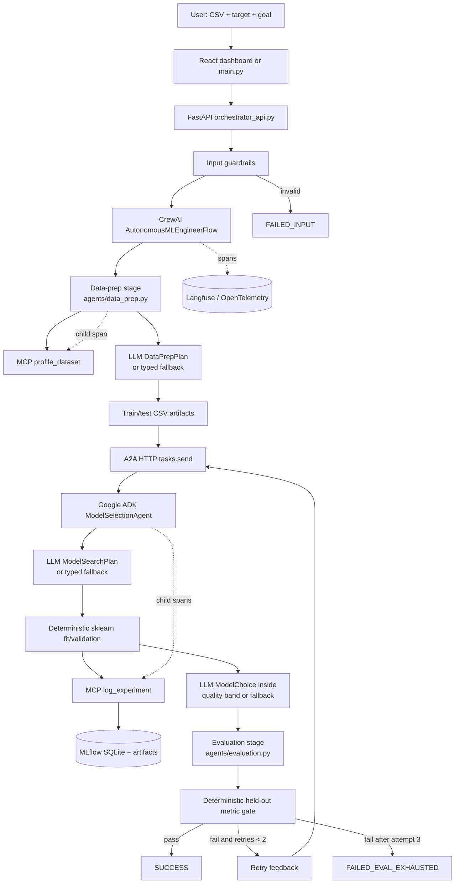

# Autonomous ML Engineer Crew — Complete Engineering Handoff

**Handoff date:** 2026-10-26 (Asia/Calcutta)  
**Workspace audited:** `C:\code\Autonomous ML Engineer Crew`  
**Status notation used throughout:**

- **Verified** — checked against the repository or executed during this handoff audit on 2026-10-26.
- **Believed** — supported by the visible conversation/work history, but not re-run or independently re-checked during this audit.
- **Unknown** — the available conversation and repository do not establish the answer.

No API key values are present in this document. Environment-variable names are listed, but secrets are intentionally omitted.

## 1. Project summary

- **Verified:** This is a typed, observable, agentic tabular-machine-learning pipeline called **Autonomous ML Engineer Crew**. It accepts a CSV file, a target column, and a natural-language prediction goal, then profiles and prepares the data, trains and tracks three candidate models, selects a winner, performs held-out evaluation, and either succeeds or retries model selection with evaluation feedback.
- **Verified:** The implementation combines CrewAI Flow, a Google ADK `BaseAgent` exposed over A2A, MCP tools, Pydantic v2 contracts, scikit-learn, MLflow, Langfuse/OpenTelemetry, FastAPI, and a React/TypeScript dashboard.
- **Verified:** The current architectural intent is not “LLM everywhere.” LLMs form a bounded policy/reasoning layer; deterministic code remains responsible for security controls, raw-row handling, model execution, metrics, thresholds, artifact persistence, and contract validation.
- **Verified:** The primary user-facing application is the compiled React dashboard served by FastAPI at `http://127.0.0.1:8000`. A legacy/additive Streamlit dashboard remains in `ui_dashboard.py`.
- **Verified:** Both regression and classification are supported. Classification candidates are Logistic Regression, Random Forest, and Gradient Boosting. Regression candidates are Linear Regression, Random Forest, and Ridge.
- **Believed:** This is at least partly a course/academic submission: the repository contains `Course_Handout__Agentic AI.pdf`, synopsis documents, a presentation, and an “AG_AI_Project_Synopsis_Template.pdf.”
- **Unknown:** The exact course name, institution, grading rubric, submission deadline, intended evaluator, production users, and deployment target were never established in the visible conversation.
- **Verified:** There is no actual deployment agent or deployed service yet. `DeploymentResult` exists as a Phase 3 contract, but normal completed pipelines end after evaluation and leave deployment absent.

## 2. Original requirements and later changes, in chronological order

The following preserves the user’s wording as closely as available. Later items override earlier ones where noted.

1. **Verified (conversation):** “Create a Python project for an Autonomous ML Engineer Crew. Tech stack: CrewAI (orchestrator + 3 agents), Google ADK (1 agent exposed as A2A service), MLflow, Langfuse, Pydantic v2.” Requested structure: `contracts/models.py`, two MCP tools, three agents, `orchestrator/flow.py`, `main.py`, and tests. Requested six Pydantic models: `PipelineState`, `DataPrepResult`, `ModelSelectionResult`, `EvaluationResult`, `DeploymentResult`, `PipelineResult` “with all fields, validators, and schema tests.”
2. **Verified (conversation):** Implement `tools/profile_dataset.py` as an MCP tool taking a CSV path and returning schema, null counts, leakage candidates, and SHA-256 as a typed `ProfileResult`; include three pytest cases.
3. **Verified (conversation):** Implement `tools/log_experiment.py` as an MLflow MCP tool supporting `create_run`, `log_params`, `log_metrics`, `register_model`, and `query_best_run`; return `ExperimentResult`; include three pytest cases.
4. **Verified (conversation):** Implement `agents/data_prep.py` as a CrewAI agent that reads a CSV, calls the profiling MCP tool, cleans and splits data, writes train/test artifacts under `/tmp/artifacts/`, and returns `DataPrepResult`.
5. **Verified (conversation):** Implement `agents/model_selection_adk.py` as a Google ADK agent exposed on `localhost:8080`; receive `DataPrepResult` via A2A; train Logistic Regression/Random Forest/GBM for classification or Linear Regression/Random Forest/Ridge for regression; call experiment logging; return `ModelSelectionResult`.
6. **Verified (conversation):** Implement `agents/evaluation.py` as a CrewAI agent taking `ModelSelectionResult`, evaluating held-out data, and returning `EvaluationResult` with pass/fail, feedback, and metrics.
7. **Verified (conversation):** Add `tests/test_day2_integration.py` with independent tests for all six contracts, profiling, experiment logging/best-run selection, data preparation artifacts, A2A service, and evaluation. Add a reusable 50-row CSV fixture in `conftest.py`.
8. **Verified (conversation):** “run it for me.” This established a preference for execution and evidence rather than code-only delivery.
9. **Verified (conversation):** Implement a CrewAI Flow with `data_prep → model_selection (A2A) → evaluation → [retry or terminal]`; retry when evaluation fails and `retry_count < 2`; terminal states `SUCCESS`, `FAILED_EVAL_EXHAUSTED`, and `FAILED_INPUT`; add five callbacks: `on_stage_start`, `on_stage_complete`, `on_stage_error`, `on_retry`, `on_validation_failure`.
10. **Verified (conversation):** Add guardrails: CSV under 100 MB, more than 10 rows, no path traversal; prompt-injection detection on `prediction_goal`; Pydantic fail-closed validation on every MCP return; never pass raw rows to an LLM prompt.
11. **Verified (conversation):** Add Langfuse/OpenTelemetry tracing with pipeline `run_id` as trace ID, one span per agent, MCP child spans, A2A span with task type/retry count, and raw-row redaction.
12. **Verified (conversation):** Test implementations and explain how to run the current completion.
13. **Verified (conversation):** Add `scripts/run_e2e.py` and `scripts/run_forced_fail.py`; use Titanic via seaborn or a generated 500-row house-price dataset; print stage JSON, final result, trace URL/local trace notice, retry progression, exhausted terminal state, and retry spans; run both.
14. **Verified (conversation):** Load `.env` from `orchestrator/telemetry.py` with `python-dotenv`, add `python-dotenv` to `pyproject.toml`, and confirm real Langfuse URLs when credentials exist.
15. **Verified (conversation):** Populate span input/output for `pipeline.run`, all agent spans, `mcp.profile_dataset`, `mcp.log_and_query_experiment`, and `a2a.tasks.send`; never log raw rows.
16. **Verified (conversation):** Create root `main.py` CLI with `--csv`, `--target`, `--goal`, and `--force-fail-eval`; use the existing Flow rather than duplicate logic; print actual UUID and stage progress.
17. **Verified (conversation):** Generate verification reports and execute prescribed tests, E2E runs, guardrail one-liners, Langfuse structure checks, MLflow UI checks, and CLI checks.
18. **Verified (conversation):** Export `run_pipeline(csv_path, target_column, prediction_goal)` at module level and make all three guardrail calls return `FAILED_INPUT` rather than crash.
19. **Verified (conversation):** The trace URL was first changed to `https://cloud.langfuse.com/trace/<run_id>` and later explicitly changed back to project-scoped form. **Superseded:** the active requirement is `https://cloud.langfuse.com/project/cmvjt4kam04c9ad0jy0a92aum/traces/<run_id>`.
20. **Verified (conversation):** Correct MLflow UI command to `python -m mlflow ui --backend-store-uri sqlite:///artifacts/e2e/mlflow.db --port 5001`, update reports/readmes/scripts, and create `scripts/start_mlflow.bat`.
21. **Verified (conversation):** Add a Streamlit single-page UI in `ui_dashboard.py`, with sidebar inputs, live stages, diagram, contracts/traces/MLflow tabs, guardrail demos, threading/session state, and dark styling. It was explicitly requested as additive and initially said not to modify working code.
22. **Verified (attachment):** A later request asked for a professional Vite + React 18 + TypeScript + Tailwind + Recharts + Framer Motion + Axios dashboard with FastAPI endpoints `POST /api/pipeline/run`, `GET /api/pipeline/status`, and `GET /api/pipeline/result`; target bundle under 500 KB gzipped; nine-stage timeline and dynamic result tabs. **Supersedes the Streamlit UI as the primary UI**, although the Streamlit file remains.
23. **Verified (conversation):** “make sure all components are integratd properly and there is no gap in frontend and backend . report after verification.”
24. **Verified (conversation):** Fix a `127.0.0.1:8000` root response of `{"detail":"Not Found"}` and fix the CSV drop area not being clickable.
25. **Verified (conversation):** Explain the full workflow simply, document how to run it, and create a proper README.
26. **Verified (attachment):** Enhance the React dashboard with dynamic reasoning for every pipeline decision. “All data comes from the API response, not hardcoded.” Add `ReasoningPanel`, `ReasoningDisplay`, dynamic model comparison/metric rendering, retry history, and API reasoning payloads.
27. **Verified (attachment):** Add Gemini reasoning through `orchestrator/llm_provider.py` and `orchestrator/llm_reasoning.py`, integrate stage reasoning and summary, surface it in the API, fail safely when LLM calls fail, and keep existing tests passing.
28. **Verified (conversation):** Check `.env`, keys, and integration; “nothing should be hardcoded”; run the project. Later asked to check updated Gemini and OpenRouter keys.
29. **Verified (conversation):** Analyze the latest Iris run (`target=species/Species`, goal approximately “classify species”) and separate what LLMs did from deterministic work.
30. **Verified (conversation):** Latest design direction: “this is an agentic ai project , so i only use deterministic where only necessary and repititive tasks . rest i want llms to reason , suggest and implement”. This superseded the earlier post-hoc-reasoning-only design. The implemented response was a typed LLM policy layer that proposes executable data-prep and model-search actions and chooses among quality-eligible models.
31. **Verified (current request):** Produce this complete handoff using conversation plus code; status-label claims; expose no secret values; include setup, architecture, requirements, progress, failures, Git output, and dependencies.

## 3. Requirements checklist

### Core contracts and tools

- **Done — Verified:** Six requested Pydantic contract classes exist in `contracts/models.py`: `DataPrepResult`, `ModelSelectionResult`, `EvaluationResult`, `DeploymentResult`, `PipelineState`, and `PipelineResult`. Validators forbid unknown fields and enforce cross-field invariants.
- **Done — Verified:** Supporting enums also exist: `TaskType`, `PipelineStatus`, `PipelineStage`, `MetricDirection`, and `HealthStatus`.
- **Done — Verified:** `tools.profile_dataset.profile_dataset()` returns typed `ProfileResult` with schema, null counts, leakage candidates, row count, column count, and SHA-256.
- **Done — Verified:** `tools.log_experiment.log_experiment()` implements the five requested MLflow actions; convenience wrappers `log_and_query_experiment()` and `query_best_run()` also exist.
- **Done — Verified:** MCP responses are explicitly revalidated using Pydantic at consuming boundaries.

### Agents and orchestration

- **Done — Verified:** Data-prep implementation reads/validates the CSV, profiles through in-memory MCP, removes missing targets/duplicates, enforces leakage exclusions, applies an LLM/fallback plan, splits, and writes artifacts.
- **Partial — Verified:** `build_data_prep_agent()` creates a CrewAI `Agent`, but the production Flow calls `run_data_prep()` directly rather than asking the CrewAI Agent to autonomously invoke its tool. This is a pragmatic wrapper, not a full conversational Crew execution.
- **Done — Verified:** `ModelSelectionAgent(BaseAgent)` is a real Google ADK agent converted to an A2A app with `to_a2a`; compatibility endpoint `/a2a/tasks/send` accepts the typed request used by the Flow.
- **Done — Verified:** Exactly three allowlisted candidates are trained for each task type, logged to MLflow, and the selected model plus held-out evaluation artifact are registered/logged.
- **Partial — Verified:** `build_evaluation_agent()` creates a CrewAI `Agent`, but production Flow calls `run_evaluation()` directly. As with data prep, the role/tool object exists but orchestration is function-driven.
- **Done — Verified:** `AutonomousMLEngineerFlow` implements data prep, A2A model selection, held-out evaluation, feedback retries, and terminal states.
- **Done — Verified:** Maximum retry count is two, producing up to three model-selection/evaluation attempts.
- **Done — Verified:** Five callback hooks exist and are tested. “All nine callbacks” in reports means nine callback events across a test scenario, not nine distinct callback function types.
- **Not started — Verified:** No deployment agent or real deployment flow exists. `DeploymentResult` is a contract placeholder.

### Agentic reasoning

- **Done — Verified:** `orchestrator/agentic_policy.py` defines typed `DataPrepPlan`, `ModelSearchPlan`, `CandidatePlan`, and `ModelChoice` decisions.
- **Done — Verified:** LLM data-prep decisions control extra exclusions, split ratio (bounded 0.15–0.30), numeric imputation, and categorical imputation after deterministic validation.
- **Done — Verified:** LLM model-search decisions configure bounded hyperparameters for all three candidates. Retry feedback is included in the next plan’s input.
- **Done — Verified:** LLM model choice is limited to candidates within a deterministic one-percent quality band. Invalid choices fail closed.
- **Done — Verified:** Evaluation interpretation and final summaries use LLM reasoning helpers with row-free inputs.
- **Done — Verified:** `LLM_MODE=offline` disables live calls for repeatable tests.
- **Done — Verified:** Primary-provider API failure attempts the independently configured alternate provider before typed deterministic fallback.
- **Partial — Verified:** External provider availability is unreliable. Recent live results used fallbacks because OpenRouter returned credit/in-flight-limit errors and Gemini returned high-demand/deadline errors.

### Guardrails and observability

- **Done — Verified:** CSV size, row count, safe path, target existence, prompt-injection, strict MCP validation, and raw-row prompt protections exist and are tested.
- **Done — Verified:** OpenTelemetry/Langfuse spans include pipeline, agents, MCP, and A2A hierarchy with run correlation and input/output.
- **Done — Verified:** Telemetry redacts field names associated with raw rows/data before export.
- **Done — Verified:** Project-scoped Langfuse trace URLs use the actual UUID-derived trace ID.
- **Partial — Verified:** API/dashboard token counts remain `0`; actual LLM token usage is printed by providers and visible in some external traces, but is not aggregated into `PipelineResult.input_tokens/output_tokens`.

### CLI, API, UI, scripts, and documentation

- **Done — Verified:** `main.py` provides the requested CLI and uses `build_flow()`.
- **Done — Verified:** FastAPI serves the built React app at `/`, eliminating the earlier root 404.
- **Done — Verified:** Multipart CSV upload works through `POST /api/pipeline/run`; tests cover the frontend payload contract.
- **Done — Verified:** React frontend polls status, displays metrics/timeline/reasoning/contracts/traces, and posts file/target/goal/forced-failure input.
- **Done — Verified:** React typecheck and production build passed during this audit.
- **Partial — Verified:** The requested bundle target was “<500KB gzipped.” The main app is below it, but the lazy Recharts chunk is `151.32 kB` gzip and total emitted gzip across all chunks is roughly 230 kB; this satisfies the target if interpreted as total transferred chunks, but no automated budget test exists.
- **Done — Verified:** `ui_dashboard.py` starts successfully in the current environment.
- **Partial — Verified:** Streamlit is installed in the existing environment (`1.66.1`) but is absent from `pyproject.toml`; a fresh `uv sync` is not guaranteed to install it.
- **Done — Verified:** E2E/forced-fail scripts and MLflow batch launchers exist.
- **Done — Verified:** README exists and covers core setup/run/configuration.
- **Partial — Verified:** Verification reports are stale: `reports/demo_verification.md` says 56 tests and `reports/day4_verification.md` says 54, while the current suite collects 74.

## 4. Key decisions and rationale

- **Verified:** **Policy/executor seam.** LLMs propose typed, bounded actions; deterministic executors validate and implement them. This reflects the explicit preference to reserve deterministic behavior for necessary/repetitive/safety-critical work while making LLM reasoning operational rather than merely narrative.
- **Verified:** **No raw rows in prompts or spans.** LLMs receive schema, counts, leakage candidates, task metadata, metrics, timings, URIs, and retry feedback. This prevents accidental data leakage and reduces prompt size.
- **Verified:** **Quality band before LLM choice.** The LLM may exercise judgment among empirically near-equivalent models, but cannot select a materially worse model. Classification tolerance is an absolute 0.01; regression tolerance is 1% of the best minimized value.
- **Verified:** **Allowlisted model catalog.** The LLM configures only known sklearn estimators with bounded parameters. Arbitrary code generation or arbitrary estimator import was rejected implicitly for safety and reproducibility.
- **Verified:** **Provider failover and typed fallback.** OpenRouter/Gemini failures must not take down the pipeline. The alternate provider is tried after transport/API failure; malformed structured output fails closed to deterministic policy instead of being reinterpreted.
- **Verified:** **MLflow SQLite per execution context.** CLI demos create per-run DBs under `artifacts/demo/<run>/mlflow.db`; dashboard runs share `artifacts/ui/mlflow.db`; E2E scripts use `artifacts/e2e/mlflow.db`.
- **Verified:** **A2A is a real local HTTP boundary.** The Flow posts a `ModelSelectionRequest` to `A2A_TASKS_URL`. Main/API start and stop the server automatically. This preserves the requested Google ADK/A2A separation.
- **Verified:** **React became primary UI.** Streamlit was built first as additive UI; the later professional-dashboard requirement introduced React/FastAPI and superseded Streamlit as the primary demo surface. Streamlit remains as a fallback/legacy interface.
- **Verified:** **FastAPI serves compiled assets.** One process serves both frontend and API in demo mode. Vite dev mode remains available for frontend work.
- **Verified:** **Project-scoped Langfuse URLs.** This supersedes the briefly requested global `/trace/<id>` form because direct access worked with the known project route.
- **Verified:** **Pydantic v2 at boundaries.** Extras are forbidden and cross-model/run IDs must agree; malformed MCP/A2A data is rejected.
- **Verified:** **No separate deployment implementation.** Deployment is intentionally left as Phase 3 rather than faking a deployed endpoint.
- **Believed:** A fully autonomous CrewAI Crew was not pursued because direct typed functions inside CrewAI Flow were simpler, testable, and safer. The consequence is that two “CrewAI agents” are wrappers rather than independent LLM-driven actors.

## 5. Architecture



### Data-prep agent

- **Verified:** Implementation: `agents/data_prep.py`.
- **Verified:** Role: validate/profile/clean/split tabular data and write train/test artifacts.
- **Verified:** Tool: in-memory MCP call to `tools.profile_dataset.server`; CrewAI wrapper `PrepareDatasetTool` and `build_data_prep_agent()` also exist.
- **Verified:** Input: `csv_path`, `target_column`, `run_id`, `task_type`, artifact root, prediction goal.
- **Verified:** Output: `DataPrepResult` containing hash, schema summary, findings, feature names, row counts, file URIs, and `llm_reasoning`.
- **Verified:** Prompt/config: executable policy prompt is constructed in `orchestrator.agentic_policy.plan_data_prep()`; CrewAI role/backstory lives in `build_data_prep_agent()`.
- **Verified:** Deterministic minimums: CSV guardrails, target removal, duplicate removal, leakage candidates always excluded, train-only imputation, stratified split when feasible, atomic writes.

### Model-selection ADK agent

- **Verified:** Implementation: `agents/model_selection_adk.py`.
- **Verified:** Role: receive a typed A2A task, generate/validate a bounded search plan, train three candidates, log them, choose/register a winner, and return `ModelSelectionResult`.
- **Verified:** Tool: in-memory MCP calls to `tools.log_experiment.server`; direct `MlflowClient` is also used for model/evaluation artifact logging.
- **Verified:** Input contract: `ModelSelectionRequest` with `DataPrepResult`, task type, tracking URI, experiment/model names, validation size, seed, retry feedback/attempt, and prediction goal.
- **Verified:** Output: `ModelSelectionResult` with three run IDs, winner run/model URI, parameters, metrics, and combined search/selection reasoning.
- **Verified:** Prompt/config: `plan_model_search()` and `choose_model()` in `orchestrator/agentic_policy.py`; model/provider configuration is in `.env` and `orchestrator/llm_provider.py`.
- **Verified:** Server: `app = to_a2a(root_agent, host=A2A_HOST, port=A2A_PORT)` plus compatibility route `/a2a/tasks/send`; standalone command is `python -m agents.model_selection_adk`.

### Evaluation agent

- **Verified:** Implementation: `agents/evaluation.py`.
- **Verified:** Role: download/load the selected MLflow model and held-out test artifact, compute metrics, apply a deterministic threshold, and generate feedback/reasoning.
- **Verified:** Input: `ModelSelectionResult`, task type, target column, optional threshold, tracking URI, download directory, and prior feedback.
- **Verified:** Output: `EvaluationResult` with held-out metrics, primary metric, threshold, direction, rationale, pass/fail, retry feedback, and LLM reasoning.
- **Verified:** Prompt/config: narrative prompt in `orchestrator.llm_reasoning.generate_evaluation_reasoning()`; CrewAI wrapper role/backstory in `build_evaluation_agent()`.

### Orchestrator

- **Verified:** `orchestrator.flow.AutonomousMLEngineerFlow` owns `PipelineState` and stage routing.
- **Verified:** Flow methods execute data prep, A2A model selection, evaluation, retry, and terminal marking. `run_pipeline()` is a module-level convenience wrapper that returns `PipelineState`, including typed `FAILED_INPUT` for validation failures.
- **Verified:** Five callback functions are injectable through `FlowCallbacks`.
- **Verified:** Root trace ID is the UUID’s 32-character hex. Agent/MCP/A2A spans carry row-free I/O.

### API and UI

- **Verified:** `orchestrator_api.py` exposes `GET /api/health`, `POST /api/pipeline/run`, `GET /api/pipeline/status`, and `GET /api/pipeline/result`.
- **Verified:** The API persists one in-memory current-run state and rejects concurrent runs with HTTP 409. Run history is frontend-local, not a backend database.
- **Verified:** The compiled React SPA is served from `ui/dist`; source API client is `ui/src/api.ts`; shared interfaces are `ui/src/types.ts`.
- **Verified:** The API worker starts an A2A subprocess, builds the existing Flow, publishes progress/reasoning, then stops A2A and flushes traces.

### MLflow

- **Verified:** Each candidate gets its own MLflow run with parameters, validation metrics, training time, pipeline-run tag, task type, retry attempt, and feedback tag.
- **Verified:** The winner is refit on the full prepared training set, serialized with joblib, logged, registered, and paired with held-out evaluation metadata.

## 6. Repository file map

```text
contracts/
  models.py                    Six public contracts plus enums and validators.
tools/
  profile_dataset.py           Typed CSV profiling MCP server/tool.
  log_experiment.py            Typed MLflow MCP server/tool and wrappers.
agents/
  data_prep.py                 Data preparation executor + CrewAI tool/agent wrapper.
  model_selection_adk.py       Google ADK/A2A server and model selection implementation.
  evaluation.py                Held-out evaluation executor + CrewAI wrapper.
orchestrator/
  flow.py                      CrewAI Flow, callbacks, retry loop, run_pipeline wrapper.
  telemetry.py                 Langfuse/OpenTelemetry setup, redaction, trace helpers.
  agentic_policy.py            Typed executable LLM decisions and safe fallbacks.
  llm_provider.py              Primary/secondary CrewAI LLM construction.
  llm_reasoning.py             Evaluation/summary narrative calls and fallbacks.
main.py                        CLI, guardrails, task inference, A2A lifecycle, progress.
orchestrator_api.py            FastAPI facade and compiled React host.
ui/
  src/api.ts                   Axios multipart/status/result client.
  src/types.ts                 API TypeScript contracts.
  src/components/              Dashboard, input, KPI, timeline, reasoning, result UI.
  dist/                        Generated production build served by FastAPI.
  package.json                 React/Vite dependencies and build scripts.
ui_dashboard.py                Legacy/additive Streamlit dashboard; still runnable.
scripts/
  e2e_common.py                Shared dataset, A2A, trace, and pipeline demo helpers.
  run_e2e.py                   Successful E2E demo.
  run_forced_fail.py           Two-retry exhausted demo.
  start_mlflow.bat             MLflow UI for artifacts/e2e/mlflow.db.
  start_dashboard_mlflow.bat   MLflow UI for artifacts/ui/mlflow.db.
  build_revised_project_docs.py Generates revised DOCX/PPT/image artifacts; ancillary.
tests/                         74 collected pytest cases across 12 test modules.
data/house_prices.csv          500-row generated regression demo dataset.
reports/                       Historical verification reports; counts/URLs are stale.
artifacts/                     Generated runs, SQLite DBs, models, CSVs, logs; ignored.
tmp/                           Historical test/doc build outputs; generated clutter.
mlruns/                        Local MLflow-generated content; ignored.
README.md                      Primary operator/developer documentation.
pyproject.toml                 Python metadata and declared dependencies.
uv.lock                        Locked Python environment.
.env.example                   Non-secret configuration template.
.env                           Real local configuration; ignored; never share values.
```

- **Verified — duplicate/legacy:** `ui_dashboard.py` overlaps the React dashboard and is no longer the primary surface.
- **Verified — generated:** `ui/dist`, `artifacts`, `tmp`, `mlruns`, `__pycache__`, `.pytest_cache`, and TypeScript build-info files are generated.
- **Verified — stale:** `reports/demo_verification.md` and `reports/day4_verification.md` describe earlier suite sizes and runs.
- **Verified — duplicates:** Multiple architecture diagrams and revised/original DOCX/PPT files coexist. Do not assume the newest filename is authoritative without asking the user.
- **Verified — experimental dependency:** Google ADK’s `to_a2a` implementation emits explicit experimental warnings.

## 7. Setup and running from scratch

### Versions checked

- **Verified:** Current Python: `3.12.14`.
- **Verified:** `pyproject.toml` supports `>=3.11,<3.14`.
- **Verified:** Current Node: `v24.19.0`; npm: `11.17.0`; README says Node 20+.
- **Verified:** Current uv: `0.12.8`.

### Recommended fresh setup

```powershell
cd "C:\code\Autonomous ML Engineer Crew"
uv sync --extra dev
cd ui
npm install
npm run build
cd ..
Copy-Item .env.example .env
```

- **Verified:** `uv.lock` exists and the active `.venv` is uv-style; `python -m pip` is not installed in the current environment. Therefore prefer `uv sync` over README’s current pip-based commands.
- **Partial:** README currently recommends `py -3.12 -m venv` followed by `python -m pip install -e ".[dev]"`. That should work in a conventional venv, but it does not describe the current uv-managed environment.
- **Verified:** Streamlit is not declared in `pyproject.toml`; install it explicitly for the legacy UI: `uv add --dev streamlit` (or add it properly to project dependencies first).

### Required/optional environment keys

Runtime/configuration keys supported across the local `.env`, `.env.example`, and code (this lists names only; it does not imply every optional key is present in the local `.env`):

```text
LLM_PROVIDER
LLM_MODE
LLM_MAX_TOKENS
LLM_FALLBACK_TIMEOUT_SECONDS
CREWAI_MODEL
GEMINI_API_KEY
OPENROUTER_API_KEY
LANGFUSE_PUBLIC_KEY
LANGFUSE_SECRET_KEY
LANGFUSE_BASE_URL
LANGFUSE_PROJECT_ID
A2A_TASKS_URL
A2A_BIND_HOST
A2A_BIND_PORT
MLFLOW_UI_URL
API_CORS_ORIGINS
VITE_API_PROXY_TARGET
```

Optional aliases/overrides supported in code/template: `OPEN_ROUTER_API_KEY`, `GEMINI_FALLBACK_MODEL`, `OPENROUTER_FALLBACK_MODEL`, `MLFLOW_TRACKING_URI`, and `LANGFUSE_TRACING_ENABLED`.

### Run the primary React/FastAPI application

```powershell
cd ui
npm run build
cd ..
.\.venv\Scripts\python.exe -m uvicorn orchestrator_api:app --host 127.0.0.1 --port 8000
```

Open `http://127.0.0.1:8000`.

- **Verified:** React typecheck passed on 2026-10-26.
- **Verified:** React production build passed: 2,619 modules; main JS `31.84 kB` gzip; charts chunk `151.32 kB` gzip.
- **Verified:** A currently running FastAPI process returned HTTP 200 and `{"status":"ok"}` from `/api/health` during this audit.

### Run CLI

```powershell
.\.venv\Scripts\python.exe main.py --csv data\house_prices.csv --target sale_price --goal "predict house price"
.\.venv\Scripts\python.exe main.py --csv data\house_prices.csv --target sale_price --goal "predict house price" --force-fail-eval
```

- **Verified:** During this audit, the normal CLI was run with process-local `LLM_MODE=offline` and `LANGFUSE_TRACING_ENABLED=false`; it reached `SUCCESS`, selected Ridge, produced held-out RMSE `18,271.44` below `53,204.02`, and emitted run ID `b755f0e9-66bf-4fb0-b4ec-3a49ca224c1c`.
- **Believed:** Forced-failure CLI reaches `FAILED_EVAL_EXHAUSTED` after two retries; it is covered by tests and historical reports but was not re-run during this audit.

### Run legacy Streamlit UI

```powershell
.\.venv\Scripts\python.exe -m streamlit run ui_dashboard.py --server.port 8501
```

- **Verified:** It started successfully on port 8501 during this audit, then was stopped manually (Ctrl+C exit code 1 is expected for manual interruption).
- **Partial:** A fresh declared dependency install will omit Streamlit until dependency metadata is fixed.

### Run tests

```powershell
.\.venv\Scripts\python.exe -m pytest -v --tb=short
```

- **Verified:** Fresh audit run exited `0`; pytest collected **74 tests** and all passed.
- **Verified:** Current warnings are dependency notices: Pydantic Settings incomplete forward reference, Google ADK A2A experimental warnings, CrewAI deprecations, and one MLflow/SQLAlchemy deprecation.
- **Verified:** On this managed Windows environment, A2A/asyncio tests may hang inside sandboxed socket creation; they passed outside that sandbox. This is an execution-environment issue, not an application test failure.

### MLflow

```powershell
.\scripts\start_dashboard_mlflow.bat
# or
.\scripts\start_mlflow.bat
```

Dashboard MLflow: `http://127.0.0.1:5001`, backed by `sqlite:///artifacts/ui/mlflow.db`. Only one server should bind port 5001.

## 8. Current state

### Works end to end

- **Verified:** Full test suite: 74 collected, all passed on 2026-10-26.
- **Verified:** React typecheck/build succeeds.
- **Verified:** FastAPI health endpoint and compiled dashboard root are operational in the current environment.
- **Verified:** Current dashboard result is a successful Iris classification run: run ID `770f8cff-3307-40e5-a733-76389cace56d`, Logistic Regression, weighted F1 `0.9333333333333333`, threshold `0.8`, no retries.
- **Verified:** Current Iris result includes train/test artifacts, all stage payloads, MLflow run `283a5c4c8a1a48409d99d86f1d0f1e2c`, and project-scoped Langfuse URL.
- **Verified:** Offline CLI fallback completes successfully on house-price data.
- **Verified:** Guardrail, callback, tracing, frontend contract, MCP, A2A, classification, regression, and retry paths are covered by tests.

### Partial/degraded

- **Verified:** Current Iris run’s `llm_insights` are fallback text, not live LLM output. The pipeline remained operational, which is intended fail-safe behavior.
- **Verified:** Provider failures observed during recent work include OpenRouter HTTP 402 (`in_flight_budget_exhausted` or insufficient remaining credit) and Gemini HTTP 503 high demand / 504 deadline exceeded.
- **Verified:** Actual LLM token usage is not rolled into API `token_count`; it remains `0`.
- **Verified:** The CLI labels reasoning blocks `[GEMINI]` even when `LLM_MODE=offline` and reasoning is deterministic fallback. This label is misleading.
- **Verified:** Streamlit works only because it is present in the current environment, not because dependency metadata guarantees it.

### Broken/not implemented

- **Verified:** No deployment agent/service exists.
- **Verified:** No persistent API run-history backend exists; dashboard history is client-side/in-memory.
- **Verified:** Workspace is not a Git repository, so status/history/branch provenance is unavailable.
- **Verified:** Historical verification reports are not current.
- **Unknown:** Whether all buttons and layouts remain visually correct across browsers and screen sizes; no fresh browser automation was run during this audit.

## 9. Work log

1. **Believed:** Built six typed contracts and schema/validation tests.
2. **Believed:** Implemented and tested dataset-profile and MLflow MCP tools.
3. **Believed:** Implemented data prep, Google ADK/A2A model selection, and evaluation.
4. **Believed:** Added Day 2 integration coverage and reusable fixture.
5. **Believed:** Implemented CrewAI Flow, retry loop, terminal states, and callbacks.
6. **Believed:** Added CSV, injection, Pydantic, and raw-row guardrails.
7. **Believed:** Added OpenTelemetry/Langfuse trace hierarchy, span I/O, and redaction.
8. **Believed:** Built E2E and forced-failure scripts and corrected MLflow SQLite URI syntax.
9. **Believed:** Iterated trace URLs: global `/trace/<id>` was tried, then superseded by project-scoped URLs.
10. **Believed:** Built Streamlit dashboard. Later built React/FastAPI dashboard around the same Flow.
11. **Believed:** Fixed root `Not Found` by serving `ui/dist` and fixed the upload/drop control.
12. **Believed:** Added dynamic, API-driven reasoning panels.
13. **Believed:** Added post-hoc Gemini/OpenRouter reasoning with local fallbacks.
14. **Believed:** Analyzed an Iris run and found that much of the pipeline was deterministic and LLM selection reasoning could be post-hoc.
15. **Verified:** Refactored to typed executable policy: data-prep plan, bounded hyperparameter plan, and model choice inside a quality band.
16. **Verified:** Added provider failover, output token bounds, fallback timeout, and offline-test behavior.
17. **Verified:** A first fallback implementation derived a direct Gemini model and could stall for over a minute. It was bounded with `LLM_FALLBACK_TIMEOUT_SECONDS=15` and zero thinking budget.
18. **Verified:** Direct Gemini tests showed `gemini-2.5-flash` is unavailable to new users in this environment and `gemini-3.8-flash` can return deadline/high-demand errors. Do not revert to 2.5 based on old docs.
19. **Verified:** Reduced `LLM_MAX_TOKENS` to 700 after OpenRouter reported it could not afford a 1,000-token maximum.
20. **Verified:** Latest audit re-ran all tests, React build, API health, Streamlit startup, and offline CLI.

## 10. Known issues, hacks, and technical debt

- **Verified:** `ui_dashboard.py` depends on undeclared `streamlit`.
- **Verified:** README setup is pip-oriented while the active environment is uv-managed and has no `pip` module.
- **Verified:** `.env.example` comments still describe optional reasoning in places although LLM decisions now affect executable policy when available.
- **Verified:** `LLM_PROVIDER`, `CREWAI_MODEL`, `A2A_BIND_HOST`, and other keys are accessed with `os.environ[...]` in some modules; missing required config can fail at import/startup instead of producing a friendly configuration error.
- **Verified:** Fallback model derivation assumes OpenRouter model names of the form `openrouter/google/<model>` and Gemini names `gemini/<model>`.
- **Verified:** Provider failover catches broad `Exception`; error categorization and retry/backoff are minimal.
- **Verified:** OpenRouter/Gemini capacity/cost limits can make live reasoning intermittent.
- **Verified:** The deterministic fallback candidate schedules are hardcoded in `_fallback_search_plan()`; this is intentional safety policy but should be documented/configurable if requirements change.
- **Verified:** Quality-band tolerances are hardcoded (0.01 classification; 1% regression).
- **Verified:** Evaluation defaults/threshold derivation are deterministic and should be reviewed for production datasets.
- **Verified:** `main.py` displays `[GEMINI]` regardless of actual provider or fallback source.
- **Verified:** Runtime/token cost fields in `PipelineResult` are placeholders (`input_tokens=0`, `output_tokens=0`, cost effectively absent).
- **Verified:** API holds only one current run and uses module-global mutable state plus a daemon worker thread.
- **Verified:** A2A server lifecycle relies on a local port and subprocess; abrupt termination can leave port/log artifacts.
- **Verified:** MLflow SQLite stores and generated artifacts have accumulated substantially and are not cleaned automatically.
- **Verified:** `reports/` is stale and can mislead reviewers.
- **Verified:** Google ADK A2A APIs are experimental according to runtime warnings.
- **Verified:** CrewAI wrapper APIs used in tests emit deprecation warnings.
- **Verified:** No Git history exists in this directory; changes cannot be attributed or safely reverted via Git.

## 11. Work in progress right now

- **Verified:** No code-editing task is half-finished at handoff time. The latest feature implementation (agentic policy/provider fallback) is syntactically complete and tests pass.
- **Verified:** The currently running FastAPI app contains a completed Iris result, but this process is ephemeral and not a managed service.
- **Verified:** This handoff supersedes the earlier interrupted request to create `claude_HANDOFF.md`; that file was not created. The requested canonical handoff is now `HANDOFF.md`.
- **Verified:** Immediate next action should be to initialize version control or place this directory into the intended Git repository before changing code.

## 12. Prioritized next steps

1. **Verified priority:** Initialize/restore Git provenance. Confirm the intended remote and baseline before committing generated or secret files. `.env`, `artifacts`, `mlruns`, caches, and `.venv` are already ignored, but `tmp/`, `ui/dist`, build-info files, and generated documents need an explicit policy.
2. **Verified priority:** Fix dependency/setup truth: add Streamlit if the legacy dashboard is supported, or mark/remove it; update README to prefer `uv sync --extra dev`; verify a clean-room install.
3. **Verified priority:** Make provider/source status explicit in contracts/API/UI. Display `llm`, `secondary_llm`, `offline_fallback`, or `invalid_output_fallback` rather than generic `[GEMINI]`.
4. **Verified priority:** Aggregate real provider usage/token/cost into `PipelineResult` and dashboard KPI cards.
5. **Verified priority:** Add integration tests for provider-source metadata and a timeout test proving secondary-provider failure cannot stall the pipeline.
6. **Verified priority:** Decide whether Streamlit stays. If React is authoritative, archive/remove the duplicate UI after user approval.
7. **Verified priority:** Update both verification reports using the current 74-test suite and current project-scoped trace format.
8. **Verified priority:** Add durable run history and concurrency/job management if this will be more than a single-user demo.
9. **Verified priority:** Review hardcoded model catalogs, quality bands, thresholds, retry count, and fallback schedules; move changeable policy to typed configuration without weakening guardrails.
10. **Unknown priority:** Implement deployment only after the user defines target platform, approval gates, security, rollback, and expected `DeploymentResult` semantics.

## 13. Open questions requiring user input

- **Unknown:** What course/institution/rubric/deadline is this for?
- **Unknown:** Is React now the only supported UI, or must Streamlit remain maintained?
- **Unknown:** Should the generated documents/presentations be versioned, regenerated, or removed?
- **Unknown:** What Git remote/repository should contain this project?
- **Unknown:** Should live LLM decisions be mandatory, or is typed deterministic fallback acceptable for a demo when providers are unavailable?
- **Unknown:** Which provider should be primary in production, and what spending/rate limits are acceptable?
- **Unknown:** Should model choice remain restricted to the one-percent quality band, and should that tolerance be user-configurable?
- **Unknown:** What deployment platform is intended for Phase 3?
- **Unknown:** Is classification/regression-only scope final, or are time-series, clustering, text, and image tasks expected?
- **Unknown:** What data privacy/compliance requirements apply to uploaded CSVs and retained artifacts?
- **Unknown:** How long should MLflow DBs, models, uploads, and train/test CSVs be retained?

## 14. User preferences and working style

- **Verified (conversation):** Prefer action and evidence: run tests, run the project, inspect logs, open/verify traces, and report actual outputs.
- **Verified (conversation):** Prefer LLM reasoning and executable suggestions wherever judgment is useful; keep deterministic work for necessary, repetitive, secure, or objectively measurable operations.
- **Verified (conversation):** Do not hardcode credentials, run IDs, trace URLs, or values that should come from environment/runtime state.
- **Verified (conversation):** Ensure frontend and backend are genuinely integrated; do not stop at separate mock components.
- **Verified (conversation):** Guardrail failures should return clean `FAILED_INPUT`, not crash.
- **Verified (conversation):** Never send raw rows to LLM prompts or telemetry.
- **Verified (conversation):** Prefer simple explanations of the workflow while retaining complete step-by-step detail.
- **Verified (conversation):** For handoffs and documentation, “Missing context is worse than a long document.”
- **Verified (conversation):** Status claims should be evidence-based and must not overstate completion.
- **Verified (conversation):** Preserve existing working logic unless a later explicit requirement requires changing it.

## 15. If you read only one thing

**Verified:** This project is a working demo with 74 passing tests, a real CrewAI Flow, Google ADK/A2A boundary, MLflow tracking, Langfuse traces, guardrails, CLI, and React/FastAPI dashboard—but its “agentic” behavior is intentionally bounded and may fall back because external LLM providers are currently unreliable. Do not confuse successful pipeline execution with successful live LLM participation: inspect `source`/`fallback_used` in the decision spans and `llm_reasoning` text. Preserve deterministic safety and raw-row isolation, fix setup/Git/provider-source transparency first, and do not claim deployment or production readiness.

## Appendix A — Git command output

Commands run from `C:\code\Autonomous ML Engineer Crew` on 2026-10-26:

```text
> git status
fatal: not a git repository (or any of the parent directories): .git

> git log --oneline -20
fatal: not a git repository (or any of the parent directories): .git
```

## Appendix B — Dependency list from `pyproject.toml`

```toml
[build-system]
requires = ["hatchling>=1.27"]
build-backend = "hatchling.build"

[project]
name = "autonomous-ml-engineer-crew"
version = "0.1.0"
description = "A typed multi-agent pipeline for autonomous tabular ML engineering."
requires-python = ">=3.11,<3.14"
dependencies = [
    "crewai>=1.15,<2",
    "fastapi>=0.115,<1",
    "google-adk[a2a]>=2.12,<3",
    "langfuse>=4.7,<5",
    "mcp>=1.28.1,<2",
    "mlflow>=3.5,<4",
    "opentelemetry-api>=1.30,<2",
    "opentelemetry-sdk>=1.30,<2",
    "pandas>=2.2,<4",
    "pydantic>=2.11,<3",
    "python-dotenv>=1.0,<2",
    "python-multipart>=0.0.20,<1",
    "scikit-learn>=1.6,<2",
    "uvicorn>=0.34,<1",
]

[project.optional-dependencies]
dev = [
    "pytest>=8.3,<10",
]
```

**Verified:** Frontend dependencies are separately declared in `ui/package.json`: React 18, React DOM, Axios, Framer Motion, Lucide React, Recharts, Vite, TypeScript, Tailwind CSS, PostCSS, Autoprefixer, and React type packages.
