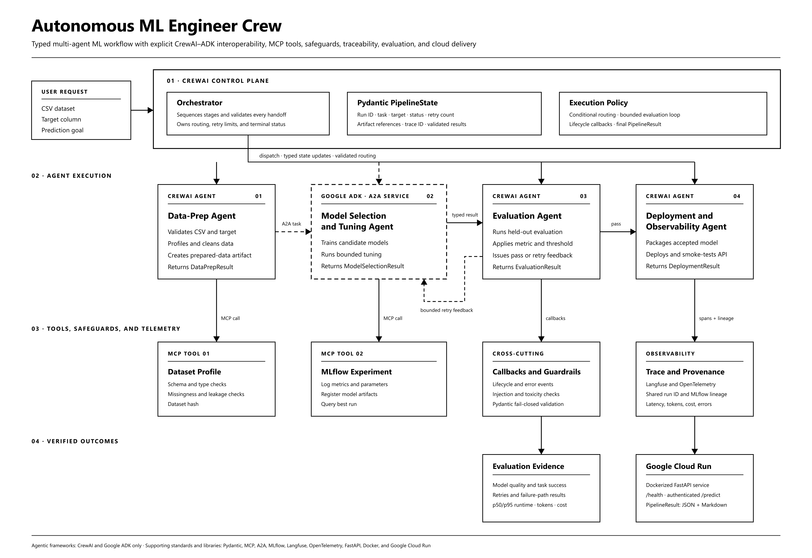

# Autonomous ML Engineer Crew

Automated machine learning for people who just have a spreadsheet. Give it a
CSV, pick the column to predict and describe the goal in plain words; a crew of
AI agents prepares the data, trains and compares models, tests the winner on
unseen data (retrying with feedback if it is not good enough), deploys it
behind a prediction API, and explains the result with charts and a model card.

The system combines a CrewAI orchestration flow, Google ADK, MCP tools, MLflow,
Langfuse/OpenTelemetry, Pydantic v2 contracts, a FastAPI boundary, and a React
dashboard.



## What it does

```text
CSV + target + prediction goal
        │
        ▼
Input guardrails
        │
        ▼
Data-prep agent ──► profile_dataset MCP tool
        │
        ▼
ADK model-selection agent over A2A ──► MLflow MCP tool
        │
        ▼
Held-out evaluation + reflection (CrewAI)
        │
        ├── pass ─► Deployment agent (/predict API) ─► SUCCESS + insights
        │
        └── fail ─► retry with feedback ──► maximum two retries
                                               │
                                               └── FAILED_EVAL_EXHAUSTED
```

Key capabilities:

- Supports regression and classification datasets.
- Uses Pydantic v2 models at every agent and tool boundary.
- Trains exactly three task-appropriate candidate models.
- Executes typed LLM data-preparation plans after deterministic validation.
- Lets the LLM configure bounded hyperparameters for all three candidates and
  apply retry feedback to the next search attempt.
- Lets the LLM choose among trained candidates inside a deterministic quality
  band, so reasoning affects the selected artifact instead of merely narrating it.
- Persists experiment parameters, metrics, artifacts, and winners in MLflow.
- Sends the model-selection task to a Google ADK agent over the real A2A
  protocol (Agent Card discovery + `SendMessage`).
- Runs the data-prep and evaluation decisions as real CrewAI crews
  (`Agent` + `Task` + `Crew`, `output_pydantic`, task guardrails).
- Records LLM tokens, latency and estimated cost per agent for every run.
- Produces correlated Langfuse/OpenTelemetry spans without logging raw rows.
- Retries failed evaluations at most twice, for three total attempts.
- Explains every run in a results dashboard built for non-experts: plain-language
  findings, feature importance, data profile (class balance, correlations,
  missing values, per-class profiles), model comparison per attempt, predicted
  vs actual / residuals or confusion matrix / per-class scores / ROC.
- Deploys the accepted model: a prediction form, CSV batch scoring and a
  `/predict` endpoint (optional `X-API-Key`); `serving/` deploys the same
  bundle to Google Cloud Run with `DEPLOY_TARGET=cloudrun`.
- Shows provenance of every decision (primary LLM, local Ollama, cache, default
  rules), the A2A Agent Card and exchanges, live provider health and saved run
  history (SQLite), with model-card and JSON downloads.
- Fails closed on invalid CSVs, prompt-injection-like or toxic goals, malformed
  A2A tasks, and malformed tool responses.

## Agentic decisions versus deterministic execution

The LLM is the policy layer. It receives row-free schemas, quality metadata,
candidate metrics, timings, the prediction goal, and retry feedback. It returns
Pydantic-validated plans that the pipeline executes:

- data-prep exclusions, split size, and imputation strategy;
- candidate-model hyperparameters, revised on retries using evaluation feedback;
- model choice among candidates that meet the quality band;
- evaluation interpretation, improvement advice, and the final run summary.

Deterministic code remains responsible for guardrails, CSV access, leakage
enforcement, splitting, transformations, model fitting, metric computation,
artifact writes, contract validation, and the final pass/fail threshold. Invalid
or unavailable LLM output falls back to a safe typed policy. Set `LLM_MODE=live`
for real decisions or `LLM_MODE=offline` for repeatable local tests.

## Who decides what

| Agent | Framework | LLM decision (typed output) | How it runs |
|---|---|---|---|
| Orchestrator | CrewAI Flow | final run summary | `orchestrator/flow.py` routes stages, owns `PipelineState`, retries |
| Data Preparation Engineer | CrewAI | `DataPrepPlan`: extra exclusions, split size, imputation | `Crew.kickoff()` in `orchestrator/crew_agents.py`, called from `agents/data_prep.py` |
| Model Selection Agent | Google ADK (`BaseAgent`, A2A server) | `ModelSearchPlan` (bounded hyperparameters) and `ModelChoice` (inside the quality band) | `agents/model_selection_adk.py`, reached only over A2A |
| Model Evaluation Engineer | CrewAI | `EvaluationReflection`: diagnosis + retry guidance | `Crew.kickoff()` in `agents/evaluation.py`; its guidance is sent back to the ADK agent on retry |

## How the course minimum requirements are met

| # | Requirement | Where it lives |
|---|---|---|
| 1 | Context sharing via state | `PipelineState` (`contracts/models.py`) owned by the Flow; each agent's typed result feeds the next (`DataPrepResult` → A2A request → `ModelSelectionResult` → `EvaluationResult` → retry feedback) |
| 2 | ≥ 2 MCP tools | `tools/profile_dataset.py` and `tools/log_experiment.py` (MCP servers, called through MCP client sessions) |
| 3 | Structured output (Pydantic) | Six contracts in `contracts/models.py`; CrewAI `output_pydantic`; final `PipelineResult` JSON + Markdown model card |
| 4 | Agentic design patterns | Sequential flow with conditional routing, tool use, planning (search plan), evaluator-optimizer **reflection loop** with bounded retries, multi-agent A2A delegation |
| 5 | Monitoring with callbacks | Flow callbacks `on_stage_start/complete/error`, `on_retry`, `on_validation_failure` (`orchestrator/flow.py`); ADK `before_agent_callback` / `after_agent_callback` |
| 6 | A2A between ADK and CrewAI | `orchestrator/a2a_client.py` (a2a-sdk client: Agent Card + `SendMessage`) → `to_a2a()` server in `agents/model_selection_adk.py` |
| 7 | Only CrewAI and ADK | No other agent framework is imported |
| 8 | Guardrails | CSV size/rows/path/target checks, prompt-injection and toxic-language checks (`main.py`), CrewAI task guardrails, ADK input-validation callback, Pydantic fail-closed parsing of every MCP/A2A return, raw rows never sent to LLMs |
| 9 | Observability | Langfuse via OpenTelemetry, one trace per `run_id` across CrewAI, A2A and ADK; MLflow lineage |
| 10 | Performance, cost, runtime | `orchestrator/usage.py` ledger → `PipelineResult.usage_report`, CLI `[USAGE]` line, dashboard cost card; held-out metrics per run |
| 11 | Cloud deployment | Planned for Phase 3 (Docker + Cloud Run) |

## Efficiency: provider chain, local LLM and decision cache

Every LLM decision is kept; efficiency comes from *where* and *how often* it runs.

| Mechanism | What it does | Config |
|---|---|---|
| Provider chain | Primary cloud model, then each fallback once, then the typed policy. No repeated retries against an overloaded or out-of-quota model. | `LLM_PROVIDER`, `CREWAI_MODEL`, `LLM_FALLBACK_CHAIN` |
| Local LLM (Ollama) | `ollama/<model>` runs on your machine: no API cost, no quota, data never leaves the machine. Used as a fallback, or as primary with `LLM_PROVIDER=ollama`. | `ollama/qwen2.5-coder:latest` |
| Narrative routing | The run summary (narration, not a decision) goes to the local model first. | `LLM_NARRATIVE_MODEL` |
| Decision cache | An identical question (same row-free inputs, same model) reuses the validated answer from `artifacts/llm_cache/`. Hits are labelled `cache` in spans, CLI and the usage report. | `LLM_CACHE=on|off` |
| Format repair | Smaller models' format slips (a bare list, numbers as strings) are normalised before validation; every bound is still enforced. | always on |
| Per-provider cost | Local calls cost $0; cloud prices per provider. The usage report shows calls, local calls, cache hits and fallbacks. | `LLM_*_COST_PER_1M`, `<PROVIDER>_*_COST_PER_1M` |

Typical runs (house prices, 500 rows): all five decisions on local Ollama in
about 43–64 s at $0.00; with the cache warm about 38 s; with LLMs offline about 5 s.
Run `scripts\llm_diag.py` to see which providers answer.

## Technology stack

| Area | Technology |
|---|---|
| Orchestration | CrewAI Flow |
| Remote agent | Google ADK exposed through A2A on `127.0.0.1:8080` (a2a-sdk client) |
| Tool protocol | MCP |
| Contracts | Pydantic v2 |
| Model training | pandas and scikit-learn |
| Experiment tracking | MLflow |
| Tracing | Langfuse and OpenTelemetry |
| Backend | FastAPI and Uvicorn |
| Frontend | React, TypeScript, Vite, Tailwind CSS, Recharts |
| Tests | pytest |

## Requirements

- Windows 10/11, macOS, or Linux
- Python `3.11` through `3.13`
- Node.js `20+` and npm
- Git is optional for local execution

The commands below use PowerShell because the project is currently developed
and verified on Windows.

## Quick start

### 1. Create the Python environment

From the project root:

With [uv](https://docs.astral.sh/uv/) (recommended; matches `uv.lock`):

```powershell
uv sync --extra dev
```

Or with plain pip:

```powershell
py -3.12 -m venv .venv
.\.venv\Scripts\python.exe -m pip install --upgrade pip
.\.venv\Scripts\python.exe -m pip install -e ".[dev]"
```

Check that your LLM keys work (prints no secrets):

```powershell
.\.venv\Scripts\python.exe scripts\llm_diag.py
```

If the existing `.venv` is already populated, this step can be skipped.

### 2. Install and build the dashboard

```powershell
cd ui
npm install
npm run build
cd ..
```

The build is required because FastAPI serves `ui/dist` at the application root.

### 3. Start the application

```powershell
.\.venv\Scripts\python.exe -m uvicorn orchestrator_api:app --host 127.0.0.1 --port 8000
```

Open <http://127.0.0.1:8000>.

The same process serves both the dashboard and `/api` endpoints. The ADK A2A
server is started and stopped automatically for each pipeline execution.

Or double-click `scripts\run_server.bat`, which (re)starts the dashboard on
<http://127.0.0.1:8765>.

### 4. Run a pipeline

1. Pick a sample (house prices, Iris, customer churn) or drop your own CSV.
2. Choose the column to predict (read from the CSV header).
3. Describe the goal in plain words.
4. Optionally enable **Retry-loop demo** (forces a failing quality bar).
5. Select **Build my model** and watch the live stage timeline.
6. Explore the tabs: Overview, Data, Models, Performance, Agents & A2A,
   Predict, Trace & contracts. Download the model card or result JSON.

Bundled datasets: `data/house_prices.csv` (target `sale_price`, regression),
`data/iris.csv` (target `Species`, 3 classes; its `Id` column is detected as
leakage and excluded automatically) and `data/customer_churn.csv` (target
`churned`, two classes; regenerate with `scripts/make_sample_data.py`).

Benchmark repeated runs (p50/p95 runtime, cost, pass rate):

```powershell
.\.venv\Scripts\python.exe scripts\benchmark.py --runs 3
```

## Configuration

The telemetry module automatically loads `.env` from the project root.

```dotenv
LLM_PROVIDER=gemini
LLM_MODE=live
LLM_MAX_TOKENS=700
LLM_FALLBACK_TIMEOUT_SECONDS=15
GEMINI_API_KEY=your-google-ai-studio-key
CREWAI_MODEL=gemini/gemini-3.8-flash

LANGFUSE_PUBLIC_KEY=pk-lf-your-key
LANGFUSE_SECRET_KEY=sk-lf-your-key
LANGFUSE_BASE_URL=https://cloud.langfuse.com
LANGFUSE_PROJECT_ID=your-project-id

A2A_AGENT_URL=http://localhost:8080
A2A_BIND_HOST=127.0.0.1
A2A_BIND_PORT=8080
MLFLOW_UI_URL=http://127.0.0.1:5055
API_CORS_ORIGINS=http://localhost:5173,http://127.0.0.1:5173
VITE_API_PROXY_TARGET=http://127.0.0.1:8000
```

Langfuse and LLM credentials are optional. Without Langfuse credentials, local
OpenTelemetry data remains available. Without the selected LLM provider key,
the deterministic ML pipeline still runs and its reasoning panels use local,
row-safe fallback explanations. Copy `.env.example` to `.env`, then replace
only the credential placeholders needed for your environment.

For OpenRouter, `OPENROUTER_API_KEY` is preferred; the compatibility alias
`OPEN_ROUTER_API_KEY` is also supported.

When both Gemini and OpenRouter credentials are present, a transport or quota
failure on the selected provider is retried once through the other provider
before the typed deterministic fallback is used. Optional
`GEMINI_FALLBACK_MODEL` and `OPENROUTER_FALLBACK_MODEL` values override the
model name derived from `CREWAI_MODEL`. `LLM_MAX_TOKENS` bounds decision output
cost, while `LLM_FALLBACK_TIMEOUT_SECONDS` prevents a secondary provider from
stalling the pipeline.

For standalone MLflow tool calls, `MLFLOW_TRACKING_URI` can also be set:

```dotenv
MLFLOW_TRACKING_URI=sqlite:///artifacts/e2e/mlflow.db
```

Never commit real secret keys.

## Running MLflow

Dashboard executions share `artifacts/ui/mlflow.db`. Start its UI with:

```powershell
.\scripts\start_dashboard_mlflow.bat
```

Then open <http://127.0.0.1:5055>.

The end-to-end scripts use `artifacts/e2e/mlflow.db`. To inspect that store, run:

```powershell
.\scripts\start_mlflow.bat
```

Only one process can use port `5055` at a time.

## Command-line usage

The pipeline can run without the dashboard:

```powershell
.\.venv\Scripts\python.exe main.py `
  --csv data/house_prices.csv `
  --target sale_price `
  --goal "predict house price"
```

To demonstrate the bounded retry path:

```powershell
.\.venv\Scripts\python.exe main.py `
  --csv data/house_prices.csv `
  --target sale_price `
  --goal "predict house price" `
  --force-fail-eval
```

`--force-fail-eval` sets the evaluation threshold to `0.99`. It is intended for
demonstrating retry behavior, not normal model acceptance.

## End-to-end demo scripts

Successful run:

```powershell
.\.venv\Scripts\python.exe scripts\run_e2e.py
```

Forced evaluation failure with two retries:

```powershell
.\.venv\Scripts\python.exe scripts\run_forced_fail.py
```

The setup attempts to load a real Titanic dataset and falls back to generating
a realistic 500-row house-price dataset when network access is unavailable.

## Development mode

For frontend work, run the backend and Vite development server separately.

Terminal 1:

```powershell
.\.venv\Scripts\python.exe -m uvicorn orchestrator_api:app --reload --port 8000
```

Terminal 2:

```powershell
cd ui
npm run dev
```

Open <http://127.0.0.1:5173>. Vite proxies `/api` requests to port `8000`.

After frontend changes, rebuild `ui/dist` before returning to the single-server
URL on port `8000`:

```powershell
cd ui
npm run build
```

## Pipeline stages

### 1. Input validation

The input boundary checks the CSV, target column, and prediction goal. Invalid
input returns a typed `FAILED_INPUT` result instead of crashing the process.

### 2. Data preparation

`agents/data_prep.py` validates and reads the CSV, drops rows with missing target
values, removes duplicates, prepares the feature set, and creates the train/test
split chosen by the Data Preparation Engineer crew (bounded to 15–30% test). Classification splits are stratified when the dataset permits
it. The resulting CSV artifacts are written under the active artifact root.

### 3. Dataset profiling MCP tool

`tools/profile_dataset.py` returns a validated profile containing:

- column schema;
- null counts;
- leakage candidates;
- row and feature metadata; and
- a SHA-256 digest of the source CSV.

### 4. ADK model selection over A2A

The CrewAI Flow never imports the ADK agent. `orchestrator/a2a_client.py`
fetches the agent's public Agent Card from `/.well-known/agent-card.json`,
then sends one A2A `SendMessage` request whose text part is the JSON
`ModelSelectionRequest`. The W3C `traceparent` header travels with it, so the
ADK side joins the same Langfuse trace. The ADK `before_agent_callback`
rejects malformed tasks before any model is trained.

`agents/model_selection_adk.py` then plans a bounded search, trains three
candidates:

| Task | Candidates |
|---|---|
| Classification | Logistic Regression, Random Forest, Gradient Boosting |
| Regression | Linear Regression, Random Forest, Ridge |

Candidate runs are logged through the MLflow MCP tool. The best run is selected,
its model is registered, and a `ModelSelectionResult` is returned through A2A.

### 5. Held-out evaluation

`agents/evaluation.py` loads the selected model and evaluates it on the test
artifact that was not used for final training.

- Classification uses weighted F1 and passes by default at `0.80` or higher.
- Regression uses RMSE and passes when RMSE is no greater than 25% of the held-out
  target standard deviation, unless an explicit threshold is provided.

The result contains the metric values, pass/fail decision, threshold rationale,
and actionable feedback.

### 6. Retry or terminal result

When evaluation fails and fewer than two retries have occurred, the flow sends
evaluation feedback back to the ADK agent and repeats model selection and
evaluation. Terminal states are:

| State | Meaning |
|---|---|
| `SUCCESS` | The held-out evaluation passed (and the model was deployed). |
| `FAILED_INPUT` | Input or guardrail validation failed. |
| `FAILED_EVAL_EXHAUSTED` | Evaluation still failed after two retries. |

## Contracts

All orchestration boundaries use models from `contracts/models.py`:

- `PipelineState`
- `DataPrepResult`
- `ModelSelectionResult`
- `EvaluationResult`
- `DeploymentResult`
- `PipelineResult`

Tool-specific results, including `ProfileResult` and `ExperimentResult`, are also
Pydantic models. External data is reparsed at each boundary so malformed tool or
A2A responses fail closed.

## Guardrails and data handling

The project enforces these controls before and during execution:

- CSV size must be less than 100 MiB.
- A dataset must contain more than 10 data rows.
- Path traversal is rejected.
- The requested target column must exist.
- Prediction goals are checked for prompt-injection-like instructions and for
  toxic or abusive language (profanity, threats, harassment).
- Raw rows are excluded from LLM prompts and telemetry.
- MCP and A2A return values are validated with Pydantic before use.
- Langfuse span payloads contain schema, metrics, hashes, and artifact URIs—not
  raw row arrays.

## Observability

Each pipeline uses its `run_id` to correlate callbacks, artifacts, MLflow runs,
and traces. The trace hierarchy is:

```text
pipeline.run
├── agent.data_prep
│   └── mcp.profile_dataset
├── agent.model_selection
│   ├── a2a.message.send
│   └── mcp.log_and_query_experiment
└── agent.evaluation
```

Every live LLM call is also recorded in a per-run usage ledger
(`orchestrator/usage.py`): agent, framework, provider, model, prompt and
completion tokens, latency and estimated cost (`LLM_INPUT_COST_PER_1M` /
`LLM_OUTPUT_COST_PER_1M`). Totals and a per-agent breakdown appear in
`PipelineResult.usage_report`, the CLI `[USAGE]` line, the saved
`pipeline_result.json` and the dashboard.

Span inputs and outputs are populated with redacted, row-safe metadata. The
dashboard presents the same hierarchy in its Traces tab and links to the
project-scoped Langfuse trace when credentials are configured.

## API

| Method | Endpoint | Purpose |
|---|---|---|
| `GET` | `/` | Serve the compiled React dashboard. |
| `GET` | `/api/health` | Liveness check. |
| `POST` | `/api/pipeline/run` | Upload a CSV and start a background run. |
| `GET` | `/api/pipeline/status` | Read live stage and retry state. |
| `GET` | `/api/pipeline/result` | Completed result, insights, decisions and A2A log. |
| `GET` | `/api/providers` | LLM provider health (no tokens spent) and cache state. |
| `POST` | `/api/guardrails/check` | Run the goal guardrails alone (`prediction_goal` form field). |
| `GET` | `/api/runs` · `/api/runs/{run_id}` | Saved run history (SQLite). |
| `GET` | `/api/runs/{run_id}/download/{model-card.md,result.json,insights.json}` | Downloads. |
| `GET` | `/api/samples` · `/api/samples/{name}` | Bundled sample datasets. |
| `GET` | `/api/deployments/{run}` · `/health` | Deployed model schema and health. |
| `POST` | `/api/deployments/{run}/predict` | `{"rows": [...]}` → predictions (+ class probabilities). |
| `POST` | `/api/deployments/{run}/predict_csv` | Upload a CSV, get it back with predictions. |
| `GET` | `/docs` | FastAPI interactive API documentation. |

The run endpoint expects multipart fields named `csv_file`, `target_column`,
`prediction_goal`, and `force_fail_eval`.

## Testing

Run the full Python suite:

```powershell
.\.venv\Scripts\python.exe -m pytest -v --tb=short
```

Run the frontend checks:

```powershell
cd ui
npm run typecheck
npm run build
npm audit --omit=dev
```

Tests cover contracts, both MCP tools, data preparation, A2A model selection,
evaluation, retries, callbacks, guardrails, tracing, and the dashboard API
contract.

## Project structure

```text
.
├── contracts/
│   └── models.py                  # Shared Pydantic v2 contracts
├── tools/
│   ├── profile_dataset.py         # Dataset-profile MCP tool
│   └── log_experiment.py          # MLflow MCP tool
├── agents/
│   ├── data_prep.py               # CrewAI data-prep agent
│   ├── model_selection_adk.py     # Google ADK/A2A model-selection agent
│   └── evaluation.py              # CrewAI held-out evaluator
├── orchestrator/
│   ├── flow.py                    # CrewAI flow and retry controller
│   └── telemetry.py               # Langfuse/OpenTelemetry integration
├── ui/                            # React dashboard
├── tests/                         # Unit and integration tests
├── scripts/
│   ├── run_e2e.py                 # Successful end-to-end run
│   ├── run_forced_fail.py         # Retry-exhaustion demonstration
│   ├── start_dashboard_mlflow.bat # Dashboard MLflow store
│   └── start_mlflow.bat           # E2E MLflow store
├── data/
│   └── house_prices.csv           # Included demonstration dataset
├── orchestrator_api.py            # FastAPI dashboard facade
├── main.py                        # CLI entry point
└── pyproject.toml                 # Python dependencies and pytest config
```

## Generated files

Normal runs create local data beneath these directories:

- `artifacts/ui/` — dashboard uploads, train/test files, models, and MLflow DB;
- `artifacts/e2e/` — end-to-end script artifacts and MLflow DB;
- `mlruns/` — default MLflow artifacts for standalone tool calls; and
- `/tmp/artifacts/` or the platform temporary directory — agent test artifacts.

These directories can grow as more experiments are executed.

## Troubleshooting

### Port 8000 is already in use

Stop the existing Uvicorn terminal with `Ctrl+C`, then start the application
again. On Windows, the listener can be identified with:

```powershell
netstat -ano | Select-String ':8000'
```

### The root URL returns `{"detail":"Not Found"}`

An older API process is still running. Stop it, rebuild the dashboard, and start
Uvicorn again:

```powershell
cd ui
npm run build
cd ..
.\.venv\Scripts\python.exe -m uvicorn orchestrator_api:app --port 8000
```

### The CSV picker appears unchanged

Use `Ctrl+Shift+R` to refresh the compiled frontend. The Run button stays disabled
until a CSV, target column, and prediction goal are all present.

### The A2A port is busy

Port `8080` is used by the local ADK service. Stop the older Python/A2A process
before starting another pipeline.

### Langfuse is unavailable

Verify the three `LANGFUSE_*` values in `.env`. The pipeline itself continues to
work without cloud tracing.

### MLflow UI does not open

Start the correct store script and confirm that port `5055` is free. The dashboard
and E2E scripts use different SQLite files.

## Verification reports

- [`reports/frontend_backend_verification.md`](reports/frontend_backend_verification.md)
- [`reports/demo_verification.md`](reports/demo_verification.md)
- [`reports/day4_verification.md`](reports/day4_verification.md)

